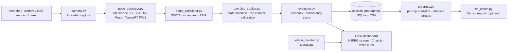

# Patient Rehabilitation Motion Evaluator

**Edge-AI physiotherapy exercise monitoring on NVIDIA Jetson Orin Nano**

[](https://github.com/Achyut0617/rehab-motion-evaluator/actions/workflows/ci.yml)
[](LICENSE)


**Contents:** [Capabilities](#key-capabilities) · [Architecture](#architecture) · [Quick Start](#quick-start-on-nvidia-jetson-orin-nano) · [Project Structure](#project-structure) · [API](#rest-api) · [Testing](#development--testing) · [License](#license)

An offline-capable, edge-AI physiotherapy exercise monitoring prototype built for **NVIDIA Jetson Orin Nano**. It captures live video from an **Android IP Camera stream** (or USB webcam), detects body landmarks locally using [MediaPipe Pose Landmarker](https://developers.google.com/edge/mediapipe/solutions/vision/pose_landmarker) (with 3D world-landmark angles and an FP16 **YOLOv8-Pose TensorRT** GPU backend), supports **left/right/both side switching** and **3-second resting-pose calibration**, streams live **`tegrastats` hardware metrics**, and logs both **session summaries and per-frame telemetry** locally in SQLite and CSV.

> **Important Scope Limitation:** This project is an AI-assisted rehabilitation exercise monitoring prototype, not a medical diagnosis or treatment device. Movement consistency scores are computational indicators, not clinically validated assessments. Thresholds in `config/exercises.json` should be reviewed by a qualified physiotherapist. No raw video is stored.

---

## Key Capabilities

- **100% Offline Local Dashboard:** Chart rendering is bundled locally in `web/static/js/chart.umd.min.js` (no internet/CDN required on isolated phone + Jetson Wi-Fi networks).
- **Per-Frame Telemetry Logging:** Active sessions record timestamped joint angles, angular velocity, stage transitions, and feedback into SQLite (`session_frames` table) and export per-session CSV files (`data/exports/session_<id>_frames.csv`).
- **3D World Landmark Angles:** Uses MediaPipe `pose_world_landmarks` (3D coordinates) to reduce perspective distortion when the patient isn't perfectly perpendicular to the camera, falling back automatically to 2D for YOLO/TensorRT.
- **TensorRT GPU Acceleration:** Includes `scripts/export_tensorrt.py` to export `yolov8n-pose.pt` to an FP16 TensorRT `.engine` in `models/` (auto-detected when `POSE_BACKEND=yolo`).
- **UI Side Selector & 3s Calibration:** Switch between **Right**, **Left**, or **Both (Avg)** in the dashboard and run a **3-second resting-pose calibration** to tailor the starting angle threshold to the patient.
- **Live Jetson `tegrastats` Monitor:** Streams CPU %, GPU %, RAM usage, temperature (°C), and power (W) directly to the dashboard header via `/api/telemetry`.

- **Patient Profiles & Personalized Targets:** Each patient has age, condition, affected side and preferred language. Target angles can be personalized per patient and exercise.
- **Per-Rep Analytics:** Range of motion, rep duration, peak speed, left/right symmetry gap and fatigue (ROM drop) for every repetition.
- **Adaptive Targets (Physio-Approved):** Rule-based suggestions after 3 sessions (raise the target if it was consistently beaten, lower it if never reached). Nothing changes until a physiotherapist clicks *Approve*.
- **Multilingual Voice Cues:** English / Hindi / Marathi on-screen feedback plus spoken rep counts and warnings, using the browser's built-in text-to-speech.
- **AI Session Reports & Physio Assistant (free Gemini API):** After each session, a patient-friendly summary (in their language), a clinician summary and flags. The physio can also ask questions about a patient's progress. The AI only explains measured metrics and never diagnoses. Patient names are never sent. Without an API key it falls back to offline template reports.

### Enabling the AI coach (free)
1. Get a free key at https://aistudio.google.com/apikey (no credit card).
2. Put it in `.env`: `GEMINI_API_KEY=your_key_here` (optional: `GEMINI_MODEL=gemini-3.5-flash-lite`).
3. Restart `python3 app.py`. The *AI Physio Assistant* badge turns green.

> TensorRT is **optional**: it only accelerates the YOLO backend on the Jetson GPU. MediaPipe, PyTorch YOLO, or demo mode work without it.

---

## Architecture



Supported exercises (configured in `config/exercises.json`): **knee extension**, **bicep curl**, **sit-to-stand**.

---

## Quick Start on NVIDIA Jetson Orin Nano

### 1. Clone the Repository
```bash
git clone https://github.com/Achyut0617/rehab-motion-evaluator.git
cd rehab-motion-evaluator
code .   # optional: open in VS Code
```
The repository ships with `yolov8n-pose.pt` and `yolov8n-pose.onnx`. A prebuilt `models/yolov8n-pose.engine` is included too, but TensorRT engines are tied to the exact JetPack/TensorRT version, so re-export it (step 3) if it fails to load.

### 2. Create Virtual Environment & Install `requirements.txt`
Ubuntu 24.04 (Python 3.12) enforces PEP 668, so always install inside `.venv`:
```bash
sudo apt update && sudo apt install -y python3-venv
chmod +x setup_jetson.sh
./setup_jetson.sh
```
Or manually:
```bash
python3 -m venv .venv --system-site-packages
source .venv/bin/activate
pip install --upgrade pip
pip install -r requirements.txt
cp .env.example .env
```

### 3. Optional: Enable FP16 TensorRT GPU Acceleration (YOLOv8-Pose)
If MediaPipe hits ARM64 wheel issues ([NVIDIA Developer Forums](https://forums.developer.nvidia.com/t/does-jetson-orin-nano-support-mediapipe/290797)) or you want GPU-accelerated inference:
```bash
source .venv/bin/activate
pip install -r requirements-tensorrt.txt
python3 scripts/export_tensorrt.py --model yolov8n-pose.pt --imgsz 640
```
Then set `POSE_BACKEND=yolo` in `.env` (it automatically loads `models/yolov8n-pose.engine`).

### 4. Connect Your Android Phone IP Camera & Run
1. Start an IP camera app (e.g., **IP Webcam** or **DroidCam**) on your Android phone on the same Wi-Fi network as your Jetson.
2. Start the Flask dashboard:
```bash
source .venv/bin/activate
python3 app.py
```
3. Open `http://localhost:5000`, paste your phone's streaming URL (e.g., `http://192.168.1.100:8080/video`) into the **Camera Source** bar, and click **Connect Camera**.

---

## Project Structure

```
rehab-motion-evaluator/
├── app.py                   # Flask app + REST API
├── config/exercises.json    # Exercise definitions & angle thresholds
├── src/                     # Core pipeline (camera, pose, angles, tracking, evaluation, storage, AI coach)
├── web/                     # Dashboard template, CSS, JS (Chart.js bundled for offline use)
├── scripts/                 # Environment check, camera/pose tests, TensorRT export, Jetson benchmark
├── tests/                   # pytest unit tests
├── docs/                    # Learning guide
├── reports/, research_notes/# Jetson edge-AI deployment research
├── models/                  # TensorRT engine
└── setup_jetson.sh          # One-shot Jetson setup
```

## REST API

| Method | Endpoint | Purpose |
|---|---|---|
| GET | `/video_feed` | Annotated MJPEG stream |
| GET | `/api/telemetry` | Live angles, reps, feedback + Jetson hardware stats |
| POST | `/api/camera` · `/api/exercise` · `/api/side` · `/api/calibrate` | Configure the live session |
| POST | `/api/session/start` · `/api/session/stop` | Record a session |
| GET | `/api/sessions` · `/api/sessions/<id>/frames(.csv)` · `/api/sessions/export.csv` | History & CSV export |
| GET/POST | `/api/patients` · `/api/patient/select` · `/api/patients/<id>/progress` · `/api/patients/<id>/targets` | Patient profiles & targets |
| POST | `/api/sessions/<id>/report` · `/api/patients/<id>/ask` | AI session report & physio Q&A |
| GET | `/api/ai/status` | Whether the Gemini coach is configured |

## Development & Testing

```bash
pip install -r requirements-dev.txt   # no GPU / ML runtime needed
ruff check .
pytest
```

CI runs lint and tests on Python 3.10 and 3.12 for every push and pull request. See [CONTRIBUTING.md](CONTRIBUTING.md) for guidelines and [SECURITY.md](SECURITY.md) for the security & patient-data policy.

## License

Released under the [MIT License](LICENSE). Pose models are from [Ultralytics YOLOv8](https://github.com/ultralytics/ultralytics) (AGPL-3.0) and [MediaPipe](https://github.com/google-ai-edge/mediapipe) (Apache-2.0); check their licenses before commercial use.
